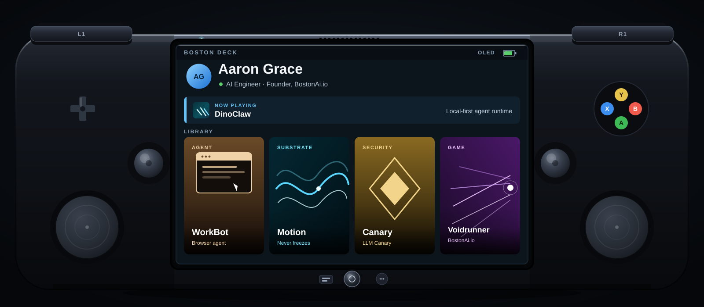

<div align="center">



<a href="https://bostonai.io"></a>
<a href="https://linkedin.com/in/aaron-grace-aa3274118"></a>
<a href="mailto:Aaron.Grace@comcast.net"></a>

<br/>


</div>

---

## `> whoami`

```yaml
name:       Aaron Grace
role:       AI Engineer · Higher-Ed Systems Analyst
company:    Founder @ BostonAi.io
location:   Dracut, Massachusetts
education:  Master of Education
focus:      local-first agent runtimes · compliance-grade data systems
```

Six years running **Ellucian Banner, ARGOS, Tableau, and federal student-aid compliance** at Middlesex Community College. Two-plus years shipping production AI products.

I build systems where **privacy is architecture, not a policy** - local-first agent runtimes, multi-provider model routing, and data pipelines that survive an audit.

---

## `> what_i_am_building`

### DinoClaw

Local-first desktop AI agent runtime. Electron + React 19 + Zustand, plan, act, verify loop, 50+ tools, multi-provider routing (OpenAI, Anthropic, Mistral, Gemini, Groq), local LLMs via Ollama.

`Electron` `React 19` `TypeScript` `Ollama`

### WorkBot

Autonomous browser agent that drives a real Chrome session end to end. Plans multi-step tasks, reads live pages, fills forms, and verifies its own work before submitting. Built with a neural model stack (fast Nexus tier + deep Apex reasoning), friction detection that pivots when a site pushes back, and local specialist models for vision and DOM understanding.

`TypeScript` `Python` `Chrome DevTools Protocol` `Ollama` `Multi-provider routing`

---

## `> stack`

<div align="center">

**Languages**


**Frameworks & Runtime**


**AI / ML**


**Data & Infra**


**Higher-Ed Systems**


</div>

---

## `> stats`

<div align="center">


<br/>


<br/>


</div>

---

## `> currently_thinking_about`

> **Continuous substrates** - agents that never freeze between frames.
>
> **Emotional state as a runtime primitive** - not a UI afterthought.
>
> **Local-first as compliance strategy** - the strongest privacy claim is the one you can prove.

---

<div align="center">

<sub>Dracut, MA · <a href="https://bostonai.io">bostonai.io</a> · <a href="mailto:Aaron.Grace@comcast.net">Aaron.Grace@comcast.net</a></sub>

</div>
